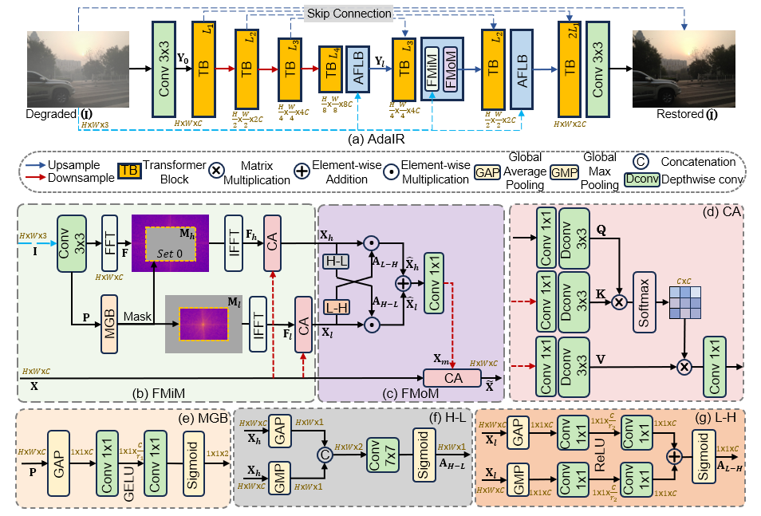
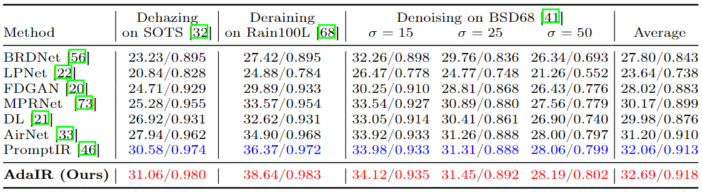
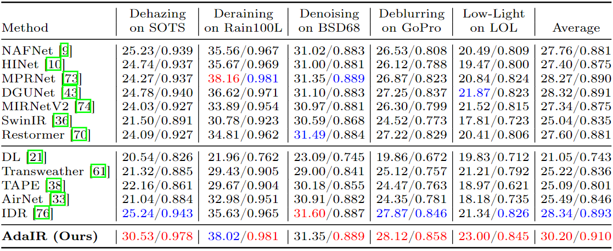

# AdaIR: Adaptive All-in-One Image Restoration via Frequency Mining and Modulation (ICLR'25)

Yuning Cui, [Syed Waqas Zamir](https://scholar.google.ae/citations?hl=en&user=POoai-QAAAAJ), [Salman Khan](https://salman-h-khan.github.io/), [Alois Knoll](https://scholar.google.com.hk/citations?user=-CA8QgwAAAAJ&hl=zh-CN&oi=ao), [Mubarak Shah](https://scholar.google.com.hk/citations?user=p8gsO3gAAAAJ&hl=zh-CN&oi=ao), and [Fahad Shahbaz Khan](https://scholar.google.es/citations?user=zvaeYnUAAAAJ&hl=en)

## 🎄 We have released the code and models for our new all-in-one model, which achieves higher performance with lower computational overhead.
## 🎁 Please refer to [BioIR](https://github.com/c-yn/BioIR) (NeurIPS 2025)

<hr />

> **Abstract:** *In the image acquisition process, various forms of degradation, including noise, blur, haze, and rain, are frequently introduced. These degradations typically arise from the inherent limitations of cameras or unfavorable ambient conditions. To recover clean images from their degraded versions, numerous specialized restoration methods have been developed, each targeting a specific type of degradation. Recently, all-in-one algorithms have garnered significant attention by addressing different types of degradations within a single model without requiring the prior information of the input degradation type. However, these methods purely operate in the spatial domain and do not delve into the distinct frequency variations inherent to different degradation types. To address this gap, we propose an adaptive all-in-one image restoration network based on frequency mining and modulation. Our approach is motivated by the observation that different degradation types impact the image content on different frequency subbands, thereby requiring different treatments for each restoration task. Specifically, we first mine low- and high-frequency information from the input features, guided by the adaptively decoupled spectra of the degraded image. The extracted features are then modulated by a bidirectional operator to facilitate interactions between different frequency components. Finally, the modulated features are merged into the original input for a progressively guided restoration. With this approach, the model achieves adaptive reconstruction by accentuating the informative frequency subbands according to different input degradations. Extensive experiments demonstrate that the proposed method, named AdaIR, achieves state-of-the-art performance on different image restoration tasks, including image denoising, dehazing, deraining, motion deblurring, and low-light image enhancement.* 
<hr />

## SWIR-AdaIR-SR (NSLSR)

Single-band SWIR all-in-one restoration + x2 super-resolution, implemented to
`SWIR_AdaIR_SR_SPEC.md` v2.1. One architecture, one checkpoint, both output
scales; the model never receives a degradation label.

Upstream AdaIR is preserved unmodified at tag `upstream-baseline`; `net/model.py`
is untouched and every addition lives in the files below.

### Layout

```
net/swir_adair_sr.py      SWIRAdaIRSR, SoftFreModule, scale heads, gated base, tiling
utils/swir_io.py          bit-depth-aware IO driven by configs/data_profile.yaml
utils/swir_degradation.py modular D_s, sim_A/sim_B, per-component RNG, metadata
utils/swir_sr_dataset.py  NSLSRSWIRDataset + scale-homogeneous batch sampler
utils/swir_metrics.py     pinned PSNR/SSIM/edge/LPIPS
utils/swir_losses.py      L1 baseline + optional SSIM/edge/frequency terms
configs/                  swir_base.yaml, sim_b.yaml, data_profile.yaml, splits.json
tools/                    inspect_dataset.py, make_splits.py, leakage_audit.py, bench.py
tests/                    63 tests: D-1..D-4, the M1 gate, DDP scale invariants
train_swir.py test_swir.py infer_swir.py detect_eval.py
```

### Order of operations

```bash
python tools/to_single_channel.py         # 3-component JPEG -> true 1-band PNG
python tools/inspect_dataset.py --root datasets/NSLSR_gray   # §9.2 -> data_profile.yaml
python tools/make_splits.py              # §9.1/§9.3 -> configs/splits.json + MANIFEST.sha256
python tools/leakage_audit.py --splits_json configs/splits.json        --query_split test --ref_splits train
pytest tests/ -q                         # M1 gate
python tools/bench.py                    # §11.1 (idle GPU only)
python train_swir.py --config configs/swir_base.yaml
python test_swir.py --ckpt runs/base/best.pth
```

Multi-GPU:

```bash
torchrun --standalone --nproc_per_node=4 train_swir.py --config configs/swir_base.yaml
```

`batch_size` is per GPU. Every rank must pick the same `out_scale` on the same step --
mixed scales mean mismatched backward shapes and a desynchronised gradient all-reduce --
so the sampler draws the scale before sharding and the trainer asserts agreement each
step. Rank 0 alone validates, checkpoints and logs.

### Read this before using the shipped split folders

`NSLSR_test` is a **strict subset** of `NSLSR_val` (all 118 ids), and both stride
the same contiguous capture sequence as `NSLSR_train` — 116 of 118 test frames
have an immediately adjacent training frame. Training on `NSLSR_train` and
reporting on `NSLSR_test` therefore produces inflated numbers and selects the
model on its own test set.

`configs/splits.json` (from `tools/make_splits.py --scheme segment`) is a
temporally disjoint replacement: 756/144/144 frames, zero id overlap, zero
held-out frames adjacent to a training frame. Use `--scheme original` only to
reproduce published detection numbers, and disclose it.

Full evidence, including the upstream `FreModule` audit required by §21 and the
current milestone-gate status, is in `runs/M1_M2_EVIDENCE.md`.

### Method note

`SoftFreModule` is an explicit **architectural variant** of AdaIR's frequency
mining, not a silent repair of it. Both modes ship and are switchable:

* `upstream_integer` — the exact released integer-box mask;
* `soft_relative` — the proposed differentiable, resolution-relative window
  (project working name **Soft-FMiM**).

Ablation A2 compares them. On the released code the low-frequency branch is
identically zero at every patch size used here and `rate_conv` receives no
gradient; both facts are measured in `runs/M1_M2_EVIDENCE.md`.

## Network Architecture
 

## Installation and Data Preparation

See [INSTALL.md](INSTALL.md) for the installation of dependencies and dataset preperation required to run this codebase.

## Training

After preparing the training data in ```data/``` directory, use 
```
python train.py
```
to start the training of the model. Use the ```de_type``` argument to choose the combination of degradation types to train on. By default it is set to all the 5 degradation tasks (denoising, deraining, dehazing, deblurring, enhancement).

Example Usage: If we only want to train on deraining and dehazing:
```
python train.py --de_type derain dehaze
```

## Testing

After preparing the testing data in ```test/``` directory, place the mode checkpoint file in the ```ckpt``` directory. The pre-trained model can be downloaded [here](https://drive.google.com/drive/folders/1x2LN4kWkO3S65jJlH-1INUFiYt8KFzPH?usp=sharing). To perform the evaluation, use
```
python test.py --mode {n}
```
```n``` is a number that can be used to set the tasks to be evaluated on, 0 for denoising, 1 for deraining, 2 for dehazing, 3 for deblurring, 4 for enhancement, 5 for three-degradation all-in-one setting and 6 for five-degradation all-in-one setting.

Example Usage: To test on all the degradation types at once, run:

```
python test.py --mode 6
```
<!-- 
## Demo
To obtain visual results from the model ```demo.py``` can be used. After placing the saved model file in ```ckpt``` directory, run:
```
python demo.py --test_path {path_to_degraded_images} --output_path {save_images_here}
```
Example usage to run inference on a directory of images:
```
python demo.py --test_path './test/demo/' --output_path './output/demo/'
```
Example usage to run inference on an image directly:
```
python demo.py --test_path './test/demo/image.png' --output_path './output/demo/'
```
To use tiling option while running ```demo.py``` set ```--tile``` option to ```True```. The Tile size and Tile overlap parameters can be adjusted using ```--tile_size``` and ```--tile_overlap``` options respectively. -->


## Results
Performance results of the AdaIR framework trained under the all-in-one setting.

<details>
<summary><strong>Three Distinct Degradations</strong> (click to expand) </summary>

 
</details>
<details>
<summary><strong>Five Distinct Degradations</strong> (click to expand) </summary>

 
</details><br>

The visual results can be downloaded [here](https://drive.google.com/drive/folders/1lsYFumrn3-07Vcl3TZy0dzMMA9yDTpSK?usp=sharing).

<!-- The visual results of the AdaIR model evaluated under the all-in-one setting can be downloaded [here](https://drive.google.com/drive/folders/1Sm-mCL-i4OKZN7lKuCUrlMP1msYx3F6t?usp=sharing) -->


## Citation
If you use our work, please consider citing:
~~~
@inproceedings{cui2025adair,
title={Ada{IR}: Adaptive All-in-One Image Restoration via Frequency Mining and Modulation},
author={Yuning Cui and Syed Waqas Zamir and Salman Khan and Alois Knoll and Mubarak Shah and Fahad Shahbaz Khan},
booktitle={The Thirteenth International Conference on Learning Representations},
year={2025}
}
~~~


## Contact
Should you have any questions, please contact yuning.cui@in.tum.de


**Acknowledgment:** This code is based on the [PromptIR](https://github.com/va1shn9v/PromptIR) repository. 

